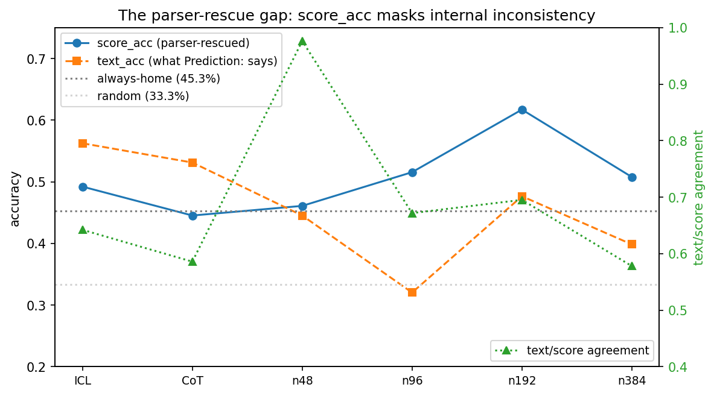

# football-llm-scaling

**The Parser-Rescue Gap: Why Small-Data Fine-Tuning Inflates Accuracy on Structured Prediction**

[](tests/)
[](pyproject.toml)
[](LICENSE)
[](#citing)

Does fine-tuning beat prompting, or does the grading make it look that way? I
fine-tuned Llama 3.1 8B with QLoRA on 192 World Cup matches and compared it
with 5-shot prompting of the same model. Under the usual rule, which takes the
`Score:` line over the stated result whenever both parse, the fine-tuned model
wins 61.7% to 49.2% (paired exact McNemar p = 0.036). Credit only answers whose
stated result, score and the truth all agree, and the gap is gone: 42.2% to
41.4% (p = 1.0).

The paper is being extended into a preprint.

## Result

Each answer has three lines: `Prediction:` (the result), `Score:` and
`Reasoning:`. I score every answer three ways. The test set is the 64 matches
of the 2022 World Cup, each asked once with team names and once anonymized
(128 answers). Brackets are Wilson 95% intervals.

| Condition | Lenient: score overrides result | Stated result only | Coherent: result = score = truth | Predicts home win |
| --- | ---: | ---: | ---: | ---: |
| Always home win | 45.3 [37.0, 53.9] | | | 100% |
| ICL, 5-shot | 49.2 [40.7, 57.8] | 56.2 [47.6, 64.5] | 41.4 [33.2, 50.1] | 82% |
| CoT, 5-step | 44.5 [36.2, 53.2] | 53.1 [44.5, 61.6] | 35.2 [27.4, 43.8] | 99% |
| QLoRA, n = 48 | 46.1 [37.7, 54.7] | 44.5 [36.2, 53.2] | 44.5 [36.2, 53.2] ¹ | 98% |
| QLoRA, n = 96 | 51.6 [43.0, 60.0] | 32.0 [24.6, 40.5] | 28.1 [21.1, 36.5] | 21% |
| **QLoRA, n = 192** | **61.7** [53.1, 69.7] | 47.7 [39.2, 56.3] | 42.2 [34.0, 50.8] | 45% |
| QLoRA, n = 384 ² | 50.8 [42.2, 59.3] | 39.8 [31.8, 48.5] | 32.0 [24.6, 40.5] | 52% |

¹ n = 48 predicts a home win on 98% of inputs, so its fields agree trivially.
² n = 384 is the original adapter, trained on 192 named and 192 anonymized
rows. The smaller adapters saw named rows only.

The fine-tuned model's lead comes from answers that contradict themselves. On
the named half, which is in-distribution for every adapter, I took every answer
whose stated result and score disagree and asked which one was right. For the
fine-tuned models the score was right 28 times to 2 at n = 96, 18 to 2 at
n = 192 and 12 to 2 at n = 384. For the prompted model it was the reverse:
4 to 9 for ICL and 6 to 13 for CoT. So the lenient rule adds points to
fine-tuning and takes them from prompting.

Fine-tuning learned the format. Every adapter answered in three lines on all
128 inputs. It did not learn to make the result and the score agree: on the
named half, the two agree on 96.9% of answers at n = 48, 46.9% at n = 96 and
64.1% at n = 192. Any benchmark that scores several fields of one answer
(function calls, JSON, tool use) can hide the same failure. Reporting
coherence-required accuracy next to the usual number catches it.



## Setup

- **Task.** From two teams' aggregated per-player statistics (API-Football,
  prior seasons only), predict the result and the score.
- **Data.** Training: the 192 matches of the 2010, 2014 and 2018 World Cups.
  Test: the 64 matches of 2022. Each match appears once with team names and
  once anonymized. Both sets are in [`data/`](data/).
- **Fine-tuning.** QLoRA on Llama-3.1-8B-Instruct (4-bit NF4, rank 16,
  α = 32, 3 epochs, learning rate 2e-4) at 48, 96 and 192 named matches.
  The subsets are nested and keep the class balance. n = 384 is the published
  adapter [`zanwenfu/football-llm-qlora`](https://huggingface.co/zanwenfu/football-llm-qlora).
- **Prompting.** The same base model. ICL uses 5 demonstrations (2 home wins,
  2 away wins, 1 draw); CoT uses a 5-step scaffold with 1,024 new tokens.
- **Decoding.** Temperature 0.1, top-p 0.9, repetition penalty 1.1. One seed,
  one T4.
- **Scoring.** The parser, the three views and the regime taxonomy are in
  [`docs/METHODS.md`](docs/METHODS.md). Paired comparisons use an exact
  McNemar test over the same 128 inputs.

## Limitations

- One task, one 8B model, one prompt format and one seed per budget. The
  n = 96 drop in field agreement needs more seeds before it is a trend.
- The 128 answers are 64 matches asked twice, so the intervals and p-values
  above, which treat them as independent, are optimistic. On either half alone (64 answers)
  they are about ±12 points.
- n = 384 changes the training mix as well as the size, so I make no scaling
  claim from n = 192 to n = 384.
- The function-calling and JSON examples in
  [`scripts/demo_structured_rescue.py`](scripts/demo_structured_rescue.py) are
  synthetic. They show how to apply the check; they are not evidence that the
  gap appears on those benchmarks.

## Reproduce

Every table and figure regenerates from the saved predictions in
[`results/raw/`](results/raw/) in about a second, with no GPU:

```bash
pip install -e .
make all
```

To retrain and re-evaluate (GPU, access to Llama 3.1 8B):

```bash
pip install -e '.[train]'
bash scripts/reproduce_paper.sh --train --eval
```

[`docs/REPRODUCIBILITY.md`](docs/REPRODUCIBILITY.md) covers each step, the
software versions, seeds and multi-seed runs.

## Use the check on your own outputs

```python
from data import load_predictions
from metrics import compute_all_splits

m = compute_all_splits(load_predictions("results/raw/scaling_predictions_n192.json"))["overall"]
print(f"{m.score_acc:.3f} {m.text_acc:.3f} {m.coherence_acc:.3f}")  # 0.617 0.477 0.422
```

[`src/structured.py`](src/structured.py) applies the same check to any set of
fields, such as a function name and its arguments. It reports primary accuracy
and coherence-required accuracy side by side; a large gap between the two is
the signature.

## Related work

The closest work is on how answer extraction moves scores:
[xFinder](https://arxiv.org/abs/2405.11874) (Yu et al., ICLR 2025),
[Lessons from the Trenches](https://arxiv.org/abs/2405.14782) (Biderman et al.,
2024) and [Finding Answers in Thought Matters](https://arxiv.org/abs/2510.14773)
(Jo et al., 2025). They study how extraction rules change measured accuracy;
this study shows a lenient multi-field rule changing which method wins.
Related threads are the mismatch between how a model is scored and what it
generates ([Lyu et al., 2024](https://arxiv.org/abs/2402.13887)), reasoning
that does not match the answer ([Turpin et al., NeurIPS 2023](https://arxiv.org/abs/2305.04388)),
format learned from few examples ([LIMA](https://arxiv.org/abs/2305.11206)),
controlled fine-tuning versus ICL comparisons
([Mosbach et al., Findings of ACL 2023](https://arxiv.org/abs/2305.16938)) and
format restrictions ([Tam et al., EMNLP 2024 Industry](https://arxiv.org/abs/2408.02442)).
Requiring every field to be right is standard elsewhere, for example joint goal
accuracy in dialogue state tracking ([MultiWOZ](https://arxiv.org/abs/1810.00278)).

## Repository

| Path | Contents |
| --- | --- |
| `src/` | Parser, metrics, regime taxonomy, data loading, training and evaluation |
| `scripts/` | Train, evaluate, analyze, plot, and the structured-output demo |
| `results/` | Saved predictions (`raw/`), tables, figures and example contradictions |
| `data/` | Training and test prompts |
| `notebooks/` | The original research notebooks |
| `docs/` | [Methods](docs/METHODS.md), [figures](docs/FIGURES.md), [reproducibility](docs/REPRODUCIBILITY.md) |
| `tests/` | Unit tests, run in CI |

## Citing

The preprint is coming. Until then, please cite the repository:

```bibtex
@misc{fu2026parserrescue,
  author       = {Fu, Zanwen},
  title        = {The Parser-Rescue Gap: Why Small-Data Fine-Tuning
                  Inflates Accuracy on Structured Prediction},
  year         = {2026},
  howpublished = {\url{https://github.com/zanwenfu/football-llm-scaling}}
}
```

[CITATION.cff](CITATION.cff) has the same in machine-readable form.

## License

MIT. See [LICENSE](LICENSE).
